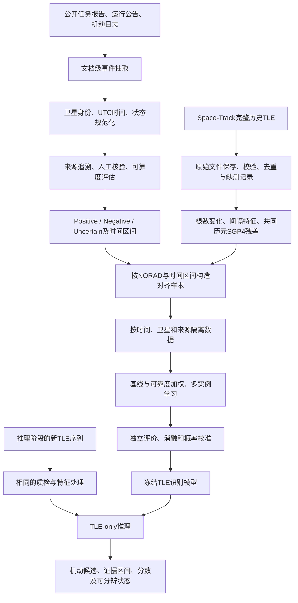

# 基于文本事件抽取与弱监督学习的卫星 TLE 轨道机动识别

## 一、研究目标与基本思路

本项目研究：**能否从公开任务报告和运行日志中自动提取可信机动事件，以低成本构造带有噪声和时间不确定性的监督信息，训练仅依赖 TLE 的轨道机动识别模型？**

文本的作用是生成训练和评价所需的事件证据。模型上线后，输入为历史 TLE 及其轨道特征，输出机动候选、证据时间区间和置信分数。轨道机动识别采用数值时序建模；NLP 负责理解报告中的卫星、时间、执行状态和事件关系。

建议将研究目标进一步限定为：在相同人工核验成本与误报预算下，检验来源可靠度和时间区间建模能否提高跨卫星机动检出率，并给出符合 TLE 观测能力的定位区间。


## 二、总体技术路线

### 2.1 训练与推理流程



### 2.2 各阶段的实施方法与产物

| 阶段 | 主要方法 | 必须保留的产物 |
|---|---|---|
| 1. 来源建设 | 收集任务方报告、IDS 日志、相关运行公告；识别转述、重复和版本变化 | 原文、URL、获取时间、发布信息、许可及证据片段 |
| 2. 事件抽取 | 结构化日志采用规则；自由文本比较序列标注、问答式抽取或受约束结构生成 | 触发词、卫星、时间表达、执行状态、目的及原文位置 |
| 3. 规范化与核验 | 卫星别名映射 NORAD；解析时区、相对时间和跨句指代；建立人工金标准 | 统一事件表、时间区间、冲突记录和抽取评价 |
| 4. 历史 TLE 获取 | 参考 SpaceTrack-TimeSeries 的认证、分批、重试与缓存思路，按目标历史区间检索 | 原始两行 TLE、查询条件、哈希、采集和质检日志 |
| 5. 轨道特征 | 完整根数、差分/变化率、采样间隔、因果背景统计及 SGP4 一致性残差 | 单星特征序列、有效性掩码和覆盖信息 |
| 6. 弱标签与对齐 | 文本提供参考标签；TLE 提供观测证据；按卫星及区间关联 | 三态标签、事件窗、证据窗、来源质量和样本索引 |
| 7. 模型学习 | 先建立简单基线，再比较可靠度加权、区间多实例学习及未标注样本处理 | 固定划分、训练配置、模型权重及验证记录 |
| 8. 评价与部署 | 文本、轨道、文本监督增益分别评价；冻结模型后仅输入 TLE | 独立测试结果、消融、误差分析和推理接口 |

## 三、关键技术设计

### 3.1 文本事件来源与抽取

当前项目事件来自 **MAD-LEO 发布的任务事件表及其保留的 IDS 原始机动记录**，涉及 CryoSat-2、Jason-3、Sentinel-3A、Sentinel-3B、SWOT，共 704 条任务事件。原始来源示例为 [IDS SWOT 机动日志](https://ids-doris.org/documents/BC/satellites/swoman.txt)。这是事件证据链的起点；Space-Track 提供轨道数据。

后续应增加不同格式的任务报告和公告，使自由文本抽取具有实际应用对象。当前 704 条事件记录对应 5 个来源文档，不能当作 704 篇独立文本；已有事件表的读取与结构日志解析也不能代表自由文本 NLP 能力。

建议统一事件结构：

```text
event_id、source_document_id、source_url、evidence_span
satellite_mention、norad_id、trigger
reported_time_text、event_time_start_utc、event_time_end_utc
time_anchor_type、execution_status、source_event_type、purpose
source_reliability、extraction_confidence、human_verification
```

时间字段还应保留原始时标、时区与归一化依据。执行状态至少区分已执行、计划、取消和不确定；计划公告不能直接生成“已机动”正例。同一机动被多篇报告重复描述时，应归并事件并保留多个来源。

借鉴 CMNEE 的文档级触发词、论元和共指处理框架，以及 Text2Event 的结构化生成方法 [R2、R4]。卫星领域的事件定义、实体映射和状态规则需要重新构建。报告中的“避碰、轨道维持”等任务目的，与 TLE 中观察到的动力学变化类型分别记录。

### 3.2 原始 TLE 获取与质量控制

SpaceTrack-TimeSeries 可作为完整 TLE 采集与时序组织的工程参考 [R1]。本项目回溯已知事件，使用 Space-Track `gp_history`，按 `NORAD_CAT_ID` 和 `EPOCH` 获取事件前后完整两行 TLE；应遵守供应方访问约定并复用缓存。

必须区分两个时间概念：

- **EPOCH**：轨道根数对应的有效历元，用于本项目的事件—轨道回溯对齐。
- **CREATION_DATE**：记录创建/发布相关时间。参考项目的日采集方式使用此字段，不能据此假定它等于轨道历元。

保存原始文本、查询 URL、时间范围、下载时间、SHA-256 和校验结果。检查行配对、校验和、卫星编号、历元顺序、重复冲突、传播有效性及缺测间隔。只有简化根数表时，不能声称已经获得完整原始 TLE 或完成对应的真实 SGP4 实验。

目前历史缓存缺少原始记录发布时间，因此属于**事后回溯实验**。如研究实时预警，需另行记录数据首次可得时间，并按当时可见的数据重放，不能用未来下载的历史数据证明实时检测延迟。

### 3.3 轨道特征与动力学证据

基础特征包括平均运动、偏心率、倾角、升交点赤经、近地点幅角、平近点角、BSTAR，以及相邻 TLE 的时间间隔。角度差分需处理周期边界；变化率应结合实际间隔计算。由平均运动推得的半长轴属于近似派生量。

SGP4 特征可将相邻两份 TLE 分别传播到共同历元，在相同 TEME 坐标系内比较位置、速度，并将位置差转换至 RTN 方向。残差反映轨道预测的一致性变化，也会受定轨误差、传播跨度和背景扰动影响，需要在正常背景上校准。

TLE 是与 SGP4 配套的平均根数，不能直接当作瞬时密切根数；传播残差也不能直接解释为实际推力或机动速度增量。持续低推力、相邻多次机动和不规则采样应作为独立困难场景分析。

### 3.4 三态标签、时间区间与弱监督

| 标签 | 建议定义 | 使用原则 |
|---|---|---|
| Positive | 独立任务证据支持已执行机动 | 保留来源、执行状态及时间区间 |
| Negative | 经独立证据核查的无机动区间 | 说明核查方法、覆盖范围和剩余不确定性 |
| Uncertain | 未标注、证据冲突、计划未确认或对照缺乏充分核查 | 不直接作为可靠负例 |

“没有找到报告”不足以证明没有机动。轨道异常可用于安排人工复核，但不能自动覆盖独立参考标签，否则会形成由输入特征定义真值的循环。缺少可靠负例时，应明确采用正例—未标注学习（PU）或其他适用协议，并说明相应假设。

对齐时分别保存报告事件时间、操作区间、分析窗口和 TLE 证据区间。报告写到毫秒，仅表示其记录精度；它不代表 TLE 能实现毫秒定位。MAD-LEO 的标准窗口可作为起点 [R3]，窗口长度和观测可用条件仍需在训练/验证阶段分析。

拟研究两项机制：

1. **可靠度加权**：依据来源、抽取错误、状态判断和人工核验信息确定监督权重。来源质量与抽取置信度分别评估，需用独立标注校准。
2. **区间多实例学习（MIL）**：将事件相关窗口作为包，将 TLE 对或局部片段作为实例，学习窗口内支持事件的证据，避免把整个窗口都标为逐点机动。

两者目前属于待实现、待验证的方法。若一个 TLE 间隔覆盖多个报告机动，应允许输出不可分辨的事件组，避免强行分配到单次机动。

### 3.5 基线与实验设计

建议依次比较：参数变化阈值、按间隔校准的稳健阈值、SGP4 残差阈值、浅层分类器或小型时序模型，再增加可靠度加权与 MIL。模型容量应服从有效序列长度和样本量。

为检验文本监督的增量，在相同轨道编码器、数据划分及人工核验预算下，比较高可信参考标签、自动抽取标签、自动标签加权、自动标签加 MIL，以及完整方法。不同数量的标签同时报告核验成本，避免把数据规模增长误当作算法改进。

评价分为三个层面：

- **文本层**：事件/论元 P、R、F1，卫星身份正确率、执行状态准确率、时间区间正确性；结构日志与自由文本分别报告。
- **轨道层**：数据覆盖率、可用窗口条件检出率、事件级一对一检出、证据区间宽度及定位误差；具备可信背景后，再报告每卫星单位时间误报和校准指标。
- **监督增益层**：相同人工成本与误报预算下，自动标签及各学习机制对下游检测的净增益。

按时间前后划分并剔除边界重叠窗口；同一事件及其重复报道不能跨集合。另做逐星留出和来源/格式留出。预处理、阈值、窗口和超参数只在训练/验证集确定。时间离线插值或双向模型若使用未来信息，必须与在线因果检测分别报告。

## 四、凝练的四个关键科学问题

### 问题一：异质文本证据如何转化为可信、可校准的机动监督？

**困难：** 报告来源质量不同，存在计划与执行混淆、卫星别名、跨句指代、重复报道和时间解析错误；多条转述也不等于多个独立证据。

**拟研究：** 将来源可靠度、抽取置信度、执行状态和核验结果分开建模，构建可追溯的事件监督及冲突裁决机制。

**验证：** 建立独立人工金标准并留出新来源/格式；比较相同核验成本下的正确事件产出及下游检出增益。仅有规则与上游 CSV 一致，不能回答此问题。

### 问题二：文本事件时间与稀疏 TLE 响应如何进行不确定性对齐？

**困难：** 文本可能只给日期或操作区间；即使时间精确，TLE 的稀疏采样、拟合和数据可得延迟仍限制定位。

**拟研究：** 分离报告时间不确定性、轨道证据区间和数据可得延迟，通过区间监督与 MIL 学习事件相关片段，并输出定位不确定性。

**验证：** 在真实粗粒度时间样本上比较固定窗口与区间方法，报告不同采样密度下的检出和区间覆盖/宽度。将精确时间人为模糊，只能作为受控退化实验单独报告。

### 问题三：稀疏、含噪的 TLE 在什么条件下能够识别并分离单次机动？

**困难：** 轨道拟合噪声可能形成残差峰；多次机动可能落入同一相邻历元对，持续报警合并后也可能掩盖多个事件。

**拟研究：** 联合参数变化、采样间隔、背景噪声和共同历元残差，分析机动的可观测条件；区分单次机动候选、持续异常段与不可分辨事件组。

**验证：** 按采样间隔、覆盖质量、相邻事件间隔及运行阶段分层，报告一对一事件匹配和区间宽度。在相同误报预算下比较方法，不能仅凭“窗口内有报警”证明准确定位。

### 问题四：弱监督能否在独立评价中带来跨卫星的实际收益？

**困难：** 已标注事件与未标注背景存在选择偏差；重叠窗口、重复来源和卫星差异可能造成信息泄漏或伪增益。

**拟研究：** 在明确负例/未标注协议下，采用时间、卫星和来源隔离，控制编码器、训练预算及核验成本，检验加权与 MIL 的独立贡献。

**验证：** 多轮逐星留出、时间外推、来源迁移及消融，报告不确定性区间和失败案例。若收益仅来自更长窗口、更宽报警区间或测试集调参，则不能支持方法有效性。

## 五、参考论文与本项目的关系

| 编号 | 论文 | 可借鉴内容 | 本项目应明确的边界 |
|---|---|---|---|
| R1 | SpaceTrack-TimeSeries，2025 | 完整 TLE 采集、整理、校验和单星时序组织 | 采集方法属于已有工作；其公开预测星历不等于机动真值 |
| R2 | CMNEE，LREC-COLING 2024 | 文档级事件定义、触发词/论元/共指、标注与抽取基线 | 文中 Manoeuvre 指军事演习，不能直接迁移为卫星机动标签 |
| R3 | MAD-LEO，2026 预印本 | 任务报告事件、时间锚点、轨道对齐与多源证据 | 文本任务标签和对齐已是已有贡献；A/B/C 证据层级不等于标签正确率或来源可信度 |
| R4 | Text2Event，ACL-IJCNLP 2021 | 受约束的事件结构生成 | 需适配卫星事件 schema，并独立评价幻觉、漏抽与时间错误 |
| R5 | Wide-scale Monitoring of Satellite Lifetimes，2022 预印本 | TLE 使用陷阱与卫星寿命监测基准经验 | 研究任务与本项目不同，主要用于数据与评价方法参考 |

### 参考文献

**[R1]** Guo, Z., et al. *SpaceTrack-TimeSeries: Time Series Dataset towards Satellite Orbit Analysis*. 2025. arXiv:2506.13034. [论文](https://arxiv.org/abs/2506.13034)；[代码](https://github.com/sjtugzx/SpaceTrack-TimeSeries)。

**[R2]** Zhu, M., Xu, Z., Zeng, K., et al. *CMNEE: A Large-Scale Document-Level Event Extraction Dataset based on Open-Source Chinese Military News*. LREC-COLING 2024, pp. 3367–3379. [会议论文](https://aclanthology.org/2024.lrec-main.299/)；[代码](https://github.com/Mzzzhu/CMNEE)。本地 `2404.12242v1.pdf` 与 `2024.lrec-main.299.pdf` 为同一研究的预印本与会议版本，应作为一项工作引用。

**[R3]** Guo, Z., Shi, Q., Xu, X., et al. *MAD-LEO: A Maneuver-Annotated Orbital Dataset for LEO Satellites with Tiered Multi-Source Evidence*. 2026. arXiv:2609.08556，预印本. [论文](https://arxiv.org/abs/2609.08556)；[代码](https://github.com/sjtugzx/madLEO)；[数据版本](https://doi.org/10.6084/m9.figshare.33446503.v1)。

**[R4]** Lu, Y., Lin, H., Xu, J., et al. *Text2Event: Controllable Sequence-to-Structure Generation for End-to-end Event Extraction*. ACL-IJCNLP 2021, pp. 2795–2806. [论文与 DOI](https://aclanthology.org/2021.acl-long.217/)。

**[R5]** Shorten, D. P., Yang, Y., Maclean, J., and Roughan, M. *Wide-scale Monitoring of Satellite Lifetimes: Pitfalls and a Benchmark Dataset*. 2022. arXiv:2212.08662. [论文](https://arxiv.org/abs/2212.08662)。

补充技术来源：[Space-Track 官方文档](https://www.space-track.org/documentation)、[CelesTrak 轨道与 SGP4 文档](https://celestrak.org/NORAD/documentation/)、[IDS SWOT 原始日志](https://ids-doris.org/documents/BC/satellites/swoman.txt)、[ILRS 机动信息](https://ilrs.gsfc.nasa.gov/data_and_products/predictions/maneuver.html)。引用论文或数据集不替代原始供应方的访问与再分发条款。

## 六、当前完成情况与证据

### 6.1 已完成的工程和真实计算

| 工作 | 当前实际状态 | 可支持的结论 |
|---|---|---|
| 数据与来源链 | 5 星、704 条任务事件、46,076 条简化轨道记录；保留 IDS 原始行 | 已建立真实事件—轨道基础表 |
| 规范化与对齐 | 已有身份/时间基础处理、窗口与覆盖检查、三态标签及划分 | 基础数据链可运行，仍需扩展格式与独立核验 |
| 简化轨道参数基线 | 704 个事件窗中 569 个可用，129 个阈值阳性，条件检出率 22.67% | 描述该固定阈值在当前可用窗口上的表现 |
| 完整原始 TLE | SWOT NORAD 54754，2023-01-10 至 01-16 查询区间，10 组通过质检 | 原始两行获取与校验的小规模流程已贯通 |
| 真实 SGP4 | 上述 10 组形成 9 对有效共同历元残差，已运行阈值推理 | 完整 TLE 到动力学证据的计算链可运行 |
| 工程测试 | 最近记录为 27 项测试通过 | 证明已测功能可运行，不能替代科研有效性评价 |

简化轨道路线有 704 个 Positive、705 个 Uncertain，当前严格 Negative 为 0；因此真实误报率、精确率和完整 F1 尚不能确立。该路线缺少原始完整角度参数，其结果应与完整 TLE/SGP4 小案例分开解释。

SWOT 小案例实际跨度内共有 6 次报告机动；其中 3 个窗口符合当前可用条件。9 对残差全部超过预设 10 km 阈值，连续合并后仅得到 1 个候选区间，不能据此宣称单次机动准确定位或“检测准确率 100%”。

### 6.2 尚未完成的核心研究

- 多来源自由文本库与独立人工金标准；目前人工 gold 为 0。
- BERT、问答式或生成式事件抽取的真实训练/评测。
- 覆盖更多卫星和正常背景的完整历史 TLE 数据。
- 来源可靠度与抽取置信度校准，以及充分核查负例或明确的 PU 协议。
- 可靠度加权、MIL 和学习型轨道识别模型训练。
- 跨时间/跨卫星泛化、消融、误报校准与统计不确定性评价。

目前已完成的是**真实数据与计算链路的原型验证**，尚未证明文本自动监督或弱监督算法优于现有方法。

### 6.3 现有证据入口

- [完整流程与逐项状态](technical_workflow.md)。
- [原始 TLE 与 SGP4 真实验证报告](raw_tle_validation_20261026.md)。
- [简化轨道基线运行目录](../outputs/runs/20261026T135515_840620Z/)。
- [SWOT 完整 TLE 单事件运行目录](../outputs/runs/20261026T140152_368463Z/)。
- [SWOT 同段六事件运行目录](../outputs/runs/20261026T140345_663465Z/)。
- [最近测试记录](../outputs/test_results/20261026T135336_491548Z/results.xml)。

## 七、预期贡献与下一步优先级

本项目的潜在贡献应集中在：**可校准的文本监督生成、文本—轨道时间不确定性对齐，以及在独立条件下验证的弱监督检测增益**。单纯完成历史 TLE 下载、导入 MAD-LEO 标签或复现文档级抽取框架，属于研究基础，不能单独作为新方法贡献。

建议按以下顺序推进：

1. **建立可信评价基础。** 扩展完整 TLE 和正常背景；核查对照，修正持续报警链式合并与多事件匹配，建立覆盖率及区间宽度敏感的评价。
2. **补齐文本监督证据。** 收集真实新格式报告，建立按来源隔离的人工 gold；先验证自动抽取是否增加可靠事件并节省核验成本。
3. **建立学习基线。** 使用浅层或小型时序模型，确定负例/未标注协议，冻结数据划分和验证选参流程。
4. **检验研究假设。** 逐项加入可靠度加权和 MIL，在固定成本、固定误报预算及跨卫星测试下进行消融；明确哪些场景有效、哪些场景受 TLE 可观测性限制。

项目进入论文结论阶段的依据，应是上述关键问题的独立实验证据，而非仅有端到端脚本成功运行。
